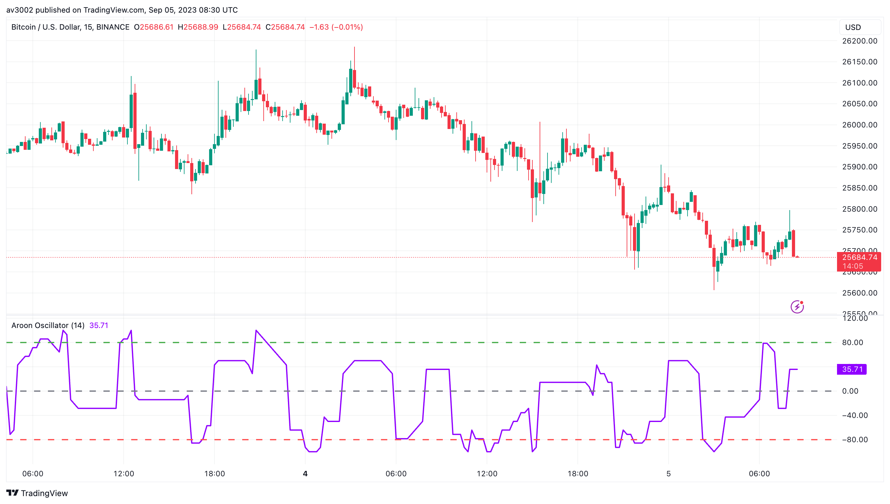
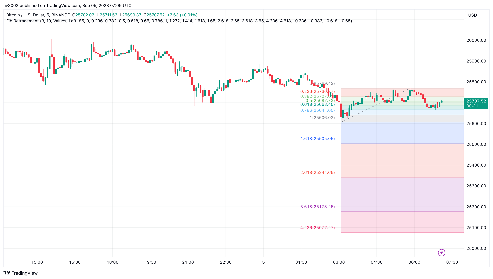
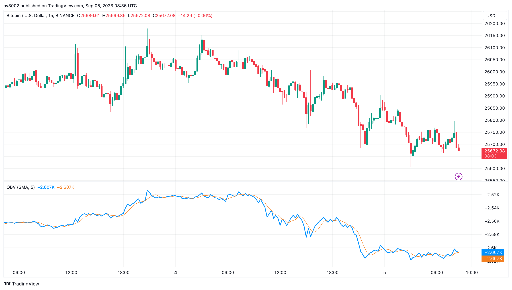
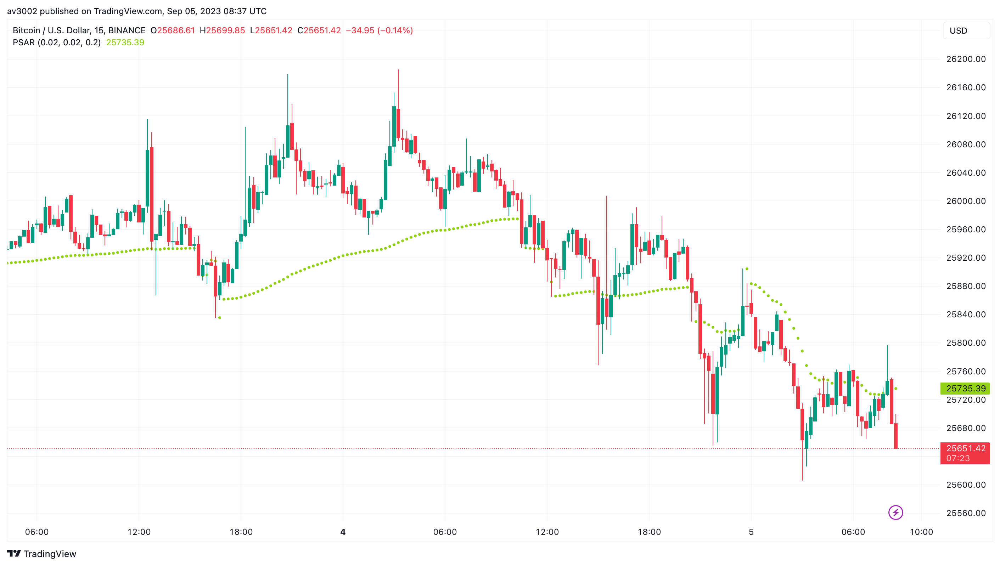

# Pine Strategy Indicators v3

Five open-source TradingView indicators written in Pine Script v6: Aroon Oscillator, Fibonacci Retracement, Ichimoku Cloud, On-Balance Volume and Parabolic SAR. Part of [GAINZ](https://gainz-trading-indicators.vercel.app), 35 indicators across seven collections.

| Indicator                                       | Type   | Script                                                                |
| ----------------------------------------------- | ------ | --------------------------------------------------------------------- |
| [Aroon Oscillator](#aroon-oscillator)           | Trend  | [`aroon-oscillator.pine`](indicators/aroon-oscillator.pine)           |
| [Fibonacci Retracement](#fibonacci-retracement) | Levels | [`fibonacci-retracement.pine`](indicators/fibonacci-retracement.pine) |
| [Ichimoku Cloud](#ichimoku-cloud)               | Trend  | [`ichimoku-cloud.pine`](indicators/ichimoku-cloud.pine)               |
| [On-Balance Volume](#on-balance-volume)         | Volume | [`on-balance-volume.pine`](indicators/on-balance-volume.pine)         |
| [Parabolic SAR](#parabolic-sar)                 | Trend  | [`parabolic-sar.pine`](indicators/parabolic-sar.pine)                 |

## Aroon Oscillator

Tracks how recently price made its highest high and its lowest low, then subtracts one from the other.

Above zero, recent highs dominate and the trend leans up. Below zero, lows dominate. A cross through zero is a change of hands.

| Setting | Default |
| ------- | ------- |
| Length  | 14      |

## Fibonacci Retracement

Finds the last major swing on its own and draws the classic Fibonacci levels across it, with prices on every line.

Watch 38.2%, 50% and 61.8% for pullbacks to stall. Deviation and depth decide how big a swing has to be to count.

| Setting   | Default |
| --------- | ------- |
| Deviation | 3       |
| Depth     | 10      |
| Extend    | Right   |

Based on TradingView's built-in Auto Fib Retracement indicator.

## Ichimoku Cloud

Five lines that show trend, momentum, support and resistance in a single view, with a cloud projected ahead of price.

Above a green cloud is bullish, below a red one bearish, inside it undecided. The cloud's edges act as support and resistance.

| Setting    | Default |
| ---------- | ------- |
| Conversion | 9       |
| Base       | 26      |
| Span B     | 52      |
| Lagging    | 26      |

Based on TradingView's built-in Ichimoku Cloud indicator.

## On-Balance Volume

Adds a bar's volume when it closes up and subtracts it when it closes down, for one running total.

OBV leading price higher hints that buyers are quietly accumulating. A divergence between the two is the warning sign.

| Setting   | Default |
| --------- | ------- |
| Smoothing | SMA 5   |

Based on TradingView's built-in On Balance Volume indicator.

## Parabolic SAR

Dots that trail price and close in faster the longer a trend runs.

Dots below price mean up, above mean down. When price touches them they flip sides, which makes a ready-made trailing stop.

| Setting  | Default |
| -------- | ------- |
| AF start | 0.02    |
| AF step  | 0.02    |
| AF max   | 0.20    |

## How to use

1. Open the indicator's `.pine` file in `indicators/` and copy the code.
2. In TradingView, open the Pine Editor, paste the code and save it.
3. Click **Add to chart**, then change the defaults in the indicator's settings.

## Disclaimer

For learning and research. Indicators describe what price has done, not what it will do. Nothing here is financial advice.

## License

[MIT](LICENSE). Indicators based on someone else's work keep their original author's terms.
